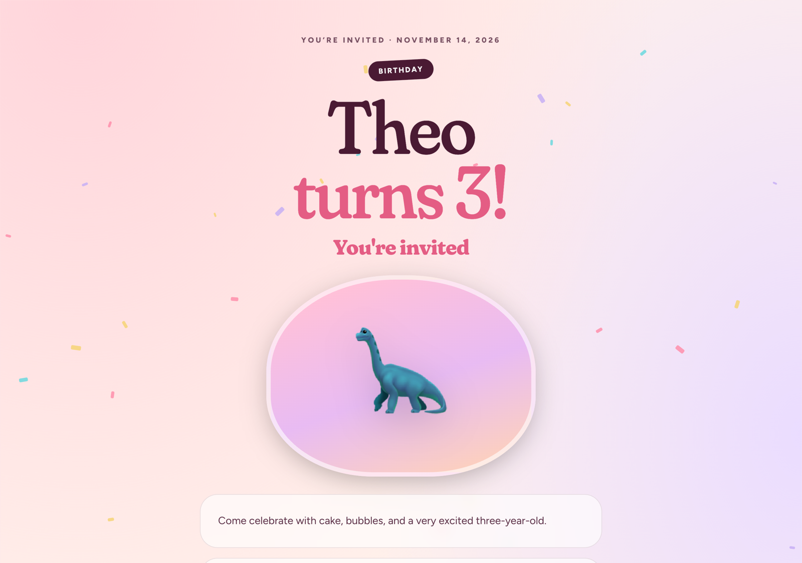
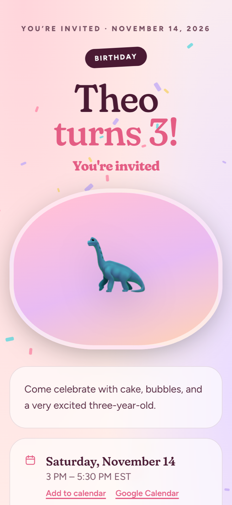
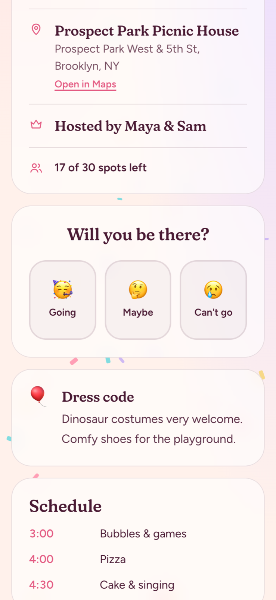
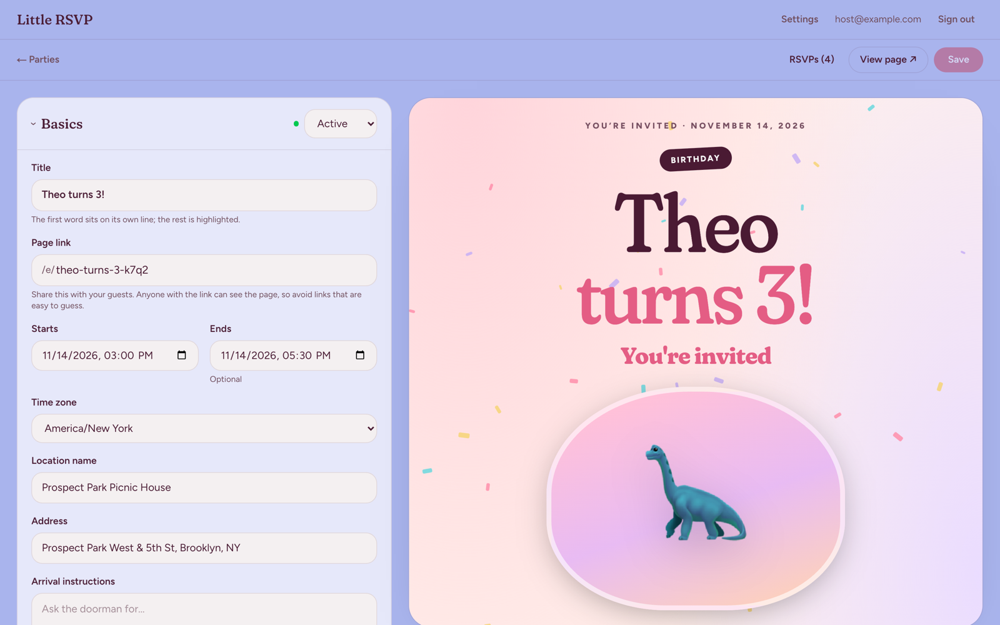
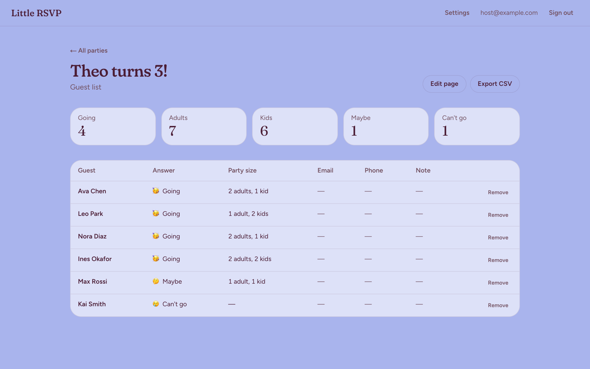
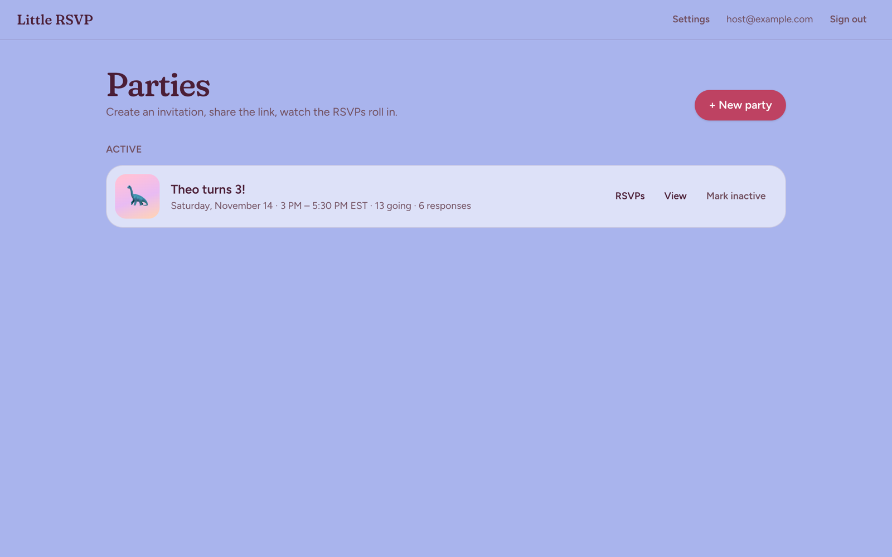
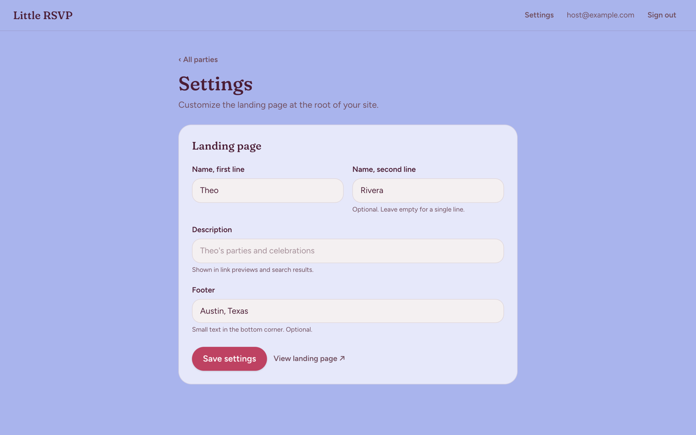

# Little RSVP

A small, self-hosted app for party invitations and RSVPs. You make a Partiful-style invite page,
send the link around, and see who's coming. There are no guest accounts and no tracking, and
everything lives in one Postgres database that you own.

- `/` is a simple landing page
- `/e/<slug>` is a party page where guests RSVP
- `/admin` is where you create and edit parties and see RSVPs (Google sign-in, allowlisted emails only)

**Stack:** Next.js 16 (standalone output) · Postgres + Drizzle · Auth.js v5 (Google) · Tailwind v4.
Cover photos and link-preview images are stored in Postgres, so the app container is stateless.

## Screenshots

<p align="center">
  
</p>

<table>
  <tr>
    <td width="33%"></td>
    <td width="33%"></td>
    <td width="33%"></td>
  </tr>
  <tr>
    <td align="center">Party page on a phone</td>
    <td align="center">Details and RSVP</td>
    <td align="center">Landing page (name set in Settings)</td>
  </tr>
</table>

**Admin**

| Event editor with live preview | Guest list |
| --- | --- |
|  |  |
| **Parties dashboard** | **Settings** |
|  |  |

## Features

- **Sections.** Every party page is a list of sections you can reorder, hide, or add:
  event details, text, callouts (dress code, parking…), schedule, links, Q&A, and guest list.
  The editor shows a live preview as you type.
- **Look and feel.** 8 themes, 6 title fonts, 6 background effects, and a cover that's either an
  uploaded photo or a big emoji. Tagline, title, subtitle, and intro copy are all editable.
- **Link previews.** Upload a share image so links look good in iMessage, WhatsApp, and Slack.
- **Active / inactive.** A party switches to inactive on its own once it ends (its end time, or
  4 hours after the start if no end is set). You can also flip it manually from the list or editor.
  Inactive pages stay online, but RSVPs close with a thank-you note.
- **RSVPs.** Guests answer Going, Maybe, or Can't go, with an optional count of adults and kids,
  a phone number or email, and a note. Guests can change their answer later (a cookie remembers
  them). You can set a spot limit and an RSVP deadline. Spot limits are enforced atomically, so
  two guests can't both take the last spot. New RSVPs are rate-limited per connection to keep
  bots from filling a party. Any guest list can be exported as CSV.
- **Add to calendar.** Every party has an `.ics` download.
- **Private by default.** Party pages are `noindex`. The admin uses JWT sessions with no user
  table, and only allowlisted Google accounts can sign in. Uploaded photos are re-encoded on the
  server, which strips location data and other metadata.

## Quick start (local)

Requirements: Node.js 20.9+ (24 recommended) and Docker (for the local Postgres).

```bash
git clone <this-repo> littlersvp && cd littlersvp
cp .env.example .env.local   # set AUTH_SECRET; uncomment DEV_LOGIN_EMAIL and add it to ADMIN_EMAILS
npm install
npm run db:up                # Postgres in Docker on port 5434 (user/password/db: littlersvp)
npm run dev
```

Open <http://localhost:3000/admin>. With `DEV_LOGIN_EMAIL` set, a **Dev login** button lets you
in without Google credentials. It only works under `next dev`, and only from `localhost`.

Migrations run automatically when the server starts. After you change `src/db/schema.ts`, run
`npm run db:generate` to create a new migration in `drizzle/`, then commit it.

### Scripts

| Script | What it does |
| --- | --- |
| `npm run dev` | Start the dev server |
| `npm run build` / `npm start` | Production build / serve |
| `npm run lint` | ESLint |
| `npm run typecheck` | `tsc --noEmit` |
| `npm run db:up` | Start the local Postgres container |
| `npm run db:generate` | Generate a migration from schema changes |
| `npm run db:migrate` | Apply migrations manually (the server also does this on boot) |

## Configuration

All configuration is through environment variables. See [`.env.example`](.env.example).

| Variable | Required | Description |
| --- | --- | --- |
| `DATABASE_URL` | yes | Postgres connection string |
| `AUTH_SECRET` | yes | Session encryption key. Generate with `npx auth secret` or `openssl rand -base64 33` |
| `AUTH_GOOGLE_ID` / `AUTH_GOOGLE_SECRET` | yes (prod) | Google OAuth client credentials |
| `AUTH_URL` | prod | Public URL of the site, e.g. `https://rsvp.example.com`. Also used for absolute share links |
| `ADMIN_EMAILS` | yes | Comma-separated Google accounts allowed into `/admin` |
| `DEV_LOGIN_EMAIL` | no | Local only: enables a password-less Dev login as this email, from `localhost` only. Ignored in production builds |
| `DATABASE_SSL` | no | Set to `require` to force TLS when your provider's URL lacks `sslmode` (Heroku) |
| `SKIP_MIGRATIONS` | no | Set to `1` to skip running migrations on boot |
| `MIGRATIONS_DIR` | no | Override the migrations folder (default `./drizzle`) |

### Google OAuth

In Google Cloud Console, go to APIs & Services → Credentials and create an *OAuth client ID* of
type Web application. Add this authorized redirect URI:

```
https://<your-domain>/api/auth/callback/google
```

For local testing with real Google sign-in, also add `http://localhost:3000/api/auth/callback/google`.

## Customizing the landing page

The landing page at `/` shows a big two-line name, a little cloud, and an optional footer.
Out of the box it reads **Little RSVP**. To make it yours (for example, your child's name):

1. Sign in at `/admin`.
2. Click **Settings** in the top bar.
3. Fill in:
   - **Name, first line** and **Name, second line**: e.g. `Theo` / `Rivera`. Leave the second
     line empty for a single-line name.
   - **Description**: shown in link previews and search results.
   - **Footer**: small text in the bottom corner, e.g. `Austin, Texas`. Leave it empty to hide it.
4. Click **Save settings**. The landing page updates right away. There's no redeploy, and nothing
   to change in code or environment variables.

Settings are stored in the `site_settings` table, so they survive redeploys and are included in
your database backups.

Going further (for forks):

- **Colors** for the landing page are CSS variables at the top of
  [`src/app/home.module.css`](src/app/home.module.css). The admin's palette lives in
  [`src/app/globals.css`](src/app/globals.css).
- **The cloud character** is an inline SVG in [`src/app/page.tsx`](src/app/page.tsx).
- **Fonts** are set up in [`src/lib/fonts.ts`](src/lib/fonts.ts).
- **Favicon and app icon**: [`src/app/icon.svg`](src/app/icon.svg),
  [`src/app/favicon.ico`](src/app/favicon.ico), and [`src/app/apple-icon.png`](src/app/apple-icon.png).

If you'd like a new option in Settings, see [CONTRIBUTING.md](CONTRIBUTING.md#adding-a-setting).

## Deploying

The repo ships with a multi-stage [`Dockerfile`](Dockerfile) that produces a small standalone
Next.js image. It runs as a non-root user, applies pending migrations on boot, and listens on
`$PORT` (default **3000**). Step-by-step guides are in **[docs/DEPLOYING.md](docs/DEPLOYING.md)**:

- [Dokploy](docs/DEPLOYING.md#dokploy)
- [Railway](docs/DEPLOYING.md#railway)
- [Heroku](docs/DEPLOYING.md#heroku) (container stack, via [`heroku.yml`](heroku.yml))
- [DigitalOcean App Platform](docs/DEPLOYING.md#digitalocean-app-platform) or a
  [Droplet with plain Docker](docs/DEPLOYING.md#digitalocean-droplet-plain-docker)

Back up your Postgres database. It holds everything, including photos.

## Project structure

```
src/
  app/
    page.tsx               landing page (name/footer come from Settings)
    e/[slug]/              public party page, RSVP actions, .ics download
    admin/                 login, not-allowed page, dashboard, event editor, settings
    api/                   Auth.js routes, image upload/serve
  components/
    event/                 party page rendering (cover, sections, RSVP card)
    admin/                 event + section editors
  db/                      Drizzle schema, client, migration runner
  lib/                     themes, fonts, sections, images, settings, queries, time helpers
  auth.ts                  Auth.js config + admin allowlist
  instrumentation.ts       runs migrations on server start
drizzle/                   SQL migrations (committed)
```

> **Heads up:** this project uses Next.js 16, which has breaking changes from earlier versions.
> When in doubt, check the docs bundled in `node_modules/next/dist/docs/`.

## Contributing

Issues and pull requests are welcome. See [CONTRIBUTING.md](CONTRIBUTING.md).
To report a security issue, see [SECURITY.md](SECURITY.md).

## License

[MIT](LICENSE)
